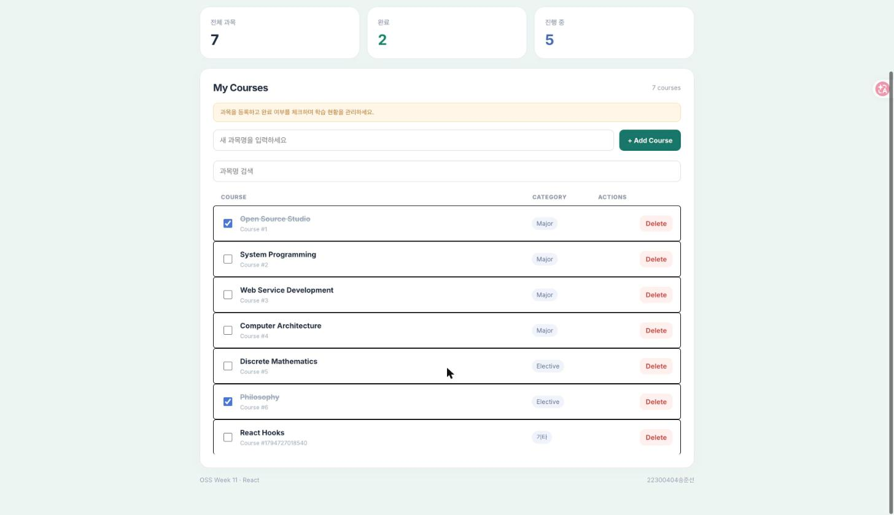

# Junsun Course Manager

# 프로젝트 소개
- React 컴포넌트, Props, State, Event를 사용한 과목 관리 웹 앱
- 과목 조회, 등록, 삭제, 완료 상태 전환, 검색, 통계 제공
- 원본 Sample Project: https://github.com/2026-2-OSS/week11_sample_project
- 원본 저작권: 원본 샘플 작성자(jerry10004)에게 있으며, 원본 커밋 기록을 그대로 유지함
- GitHub Classroom: https://github.com/2026-2-OSS/assign11-c01-22300404
- 개인 GitHub 저장소: https://github.com/Evvvaaaaan/week11__oss

# 설치 및 실행
- 앱 소스 위치: `week11_sample_project/`
- `cd week11_sample_project`
- `npm install`
- `npm run dev` 실행 후 터미널에 표시된 주소로 접속
- 빌드: `npm run build`

# 실행 화면
- 첫 화면
- 
- 과목 등록과 완료 체크
- 
- 새로 등록된 과목
- 
- 과목명 검색
- 

# 주요 파일
- `src/App.jsx`: 제목, 설명, 하단 정보를 배치하고 CourseList를 렌더링
- `src/components/CourseList.jsx`: 과목 상태를 관리하고 등록, 삭제, 완료 전환, 검색 이벤트 처리
- `src/components/CourseItem.jsx`: 과목 한 개를 표시하고 체크박스, 삭제 버튼 이벤트를 부모에 전달

# Props, State, Event 분석
- State (CourseList)
- `courses`: 과목 배열
- `newName`: 새 과목 입력값
- `search`: 검색어
- Props (CourseList → CourseItem)
- `course`: 표시할 과목 객체
- `onDelete`: 삭제 콜백
- `onToggle`: 완료 전환 콜백
- Event
- 등록 폼 `onSubmit` → `handleAdd`
- 입력창, 검색창 `onChange` → `setNewName`, `setSearch`
- 체크박스 `onChange` → `onToggle(course.id)`
- 삭제 버튼 `onClick` → `onDelete(course.id)`
- 자식은 id만 부모에 전달하고, 상태 변경은 부모의 `setCourses`가 담당

# 주요 코드 분석

## 1. 과목 등록 (`CourseList.jsx`)
```jsx
function handleAdd(event) {
  event.preventDefault();
  if (!newName.trim()) return;
  const newCourse = {
    id: Date.now(),
    name: newName.trim(),
    category: '기타',
    completed: false
  };
  setCourses(previous => [...previous, newCourse]);
  setNewName('');
}
```
- `preventDefault()`로 폼 제출 시 페이지 새로고침 방지
- `trim()`으로 빈 문자열과 공백만 있는 입력 차단
- `Date.now()`로 겹치지 않는 id 생성
- 스프레드 `[...previous, newCourse]`로 새 배열을 만들어 상태 갱신
- 상태가 바뀌면 목록과 통계가 즉시 다시 렌더링
- 등록 후 입력창 초기화

## 2. 완료 상태 전환 (`CourseList.jsx`)
```jsx
function handleToggle(id) {
  setCourses(previous => previous.map(course => {
    if (course.id === id) {
      return { ...course, completed: !course.completed };
    }
    return course;
  }));
}
```
- `map`으로 기존 배열을 직접 수정하지 않고 새 배열 생성
- id가 같은 과목만 `{ ...course }`로 복사한 뒤 `completed` 반전
- 나머지 과목은 그대로 반환
- 인덱스가 아닌 id로 찾기 때문에 검색 중에도 올바른 과목이 변경됨
- 완료된 과목은 `done` 클래스로 취소선과 회색 표시

# Customizing
- 초기 과목 6개로 변경 (`src/data/courses.js`)
- 제목 `Junsun Course Manager`, 설명, 브라우저 탭 제목 변경 (`App.jsx`, `index.html`)
- 하단에 학번과 이름 표시
- CSS 변경 (`src/App.css`)
- 배경색 `#eef5f3`
- 통계 카드 모서리 `15px` → `20px`
- 등록 버튼 색 `#167768`, 마우스 오버 색 `#105c50`
- 과목 행마다 테두리와 둥근 모서리 추가

# 기능 설명
- 조회: 과목명, 카테고리, 완료 여부 표시
- 등록: 빈 값과 공백 입력 차단, 등록 즉시 목록과 통계 갱신
- 삭제: 확인창에서 확인한 경우에만 삭제
- 완료 전환: 체크박스로 완료, 미완료 전환 및 취소선 표시
- 검색: 대소문자 구분 없이 과목명 검색, 결과가 없으면 안내 문구 표시
- 통계: 전체, 완료, 진행 중 과목 수 표시
- 데이터는 React 상태에만 저장되므로 새로고침하면 초기 과목으로 돌아감

# 배포
- Vercel URL: https://week11-webservice.vercel.app/
- GitHub에 push하면 Vercel이 자동으로 다시 배포
- 루트의 `vercel.json`이 `week11_sample_project` 폴더를 빌드하도록 설정

# Weekly Review

## 새롭게 배운 내용
- 부모 State를 Props와 콜백으로 자식에게 전달하는 구조
- `map`, `filter`, 스프레드로 새 배열을 만들어 상태 갱신
- GitHub push 후 Vercel 자동 배포

## 어려웠던 점과 해결 방법
- 검색 중 다른 과목이 바뀌지 않게 하기: 인덱스 대신 id로 처리
- 제출 저장소 구조: 앱을 하위 폴더에 두고 `vercel.json`으로 빌드 경로 지정

## AI 활용
- 검색 기능과 화면 꾸미기 구현에 AI 도움을 받음
- Claude Code로 요구사항 점검, 기능 검증, push, 화면 캡처, README 작성

## 느낀 점
- 직접 실행해서 확인하는 검증이 중요함
