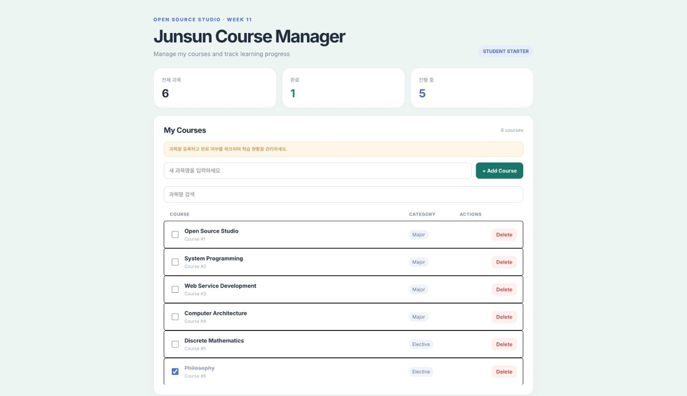
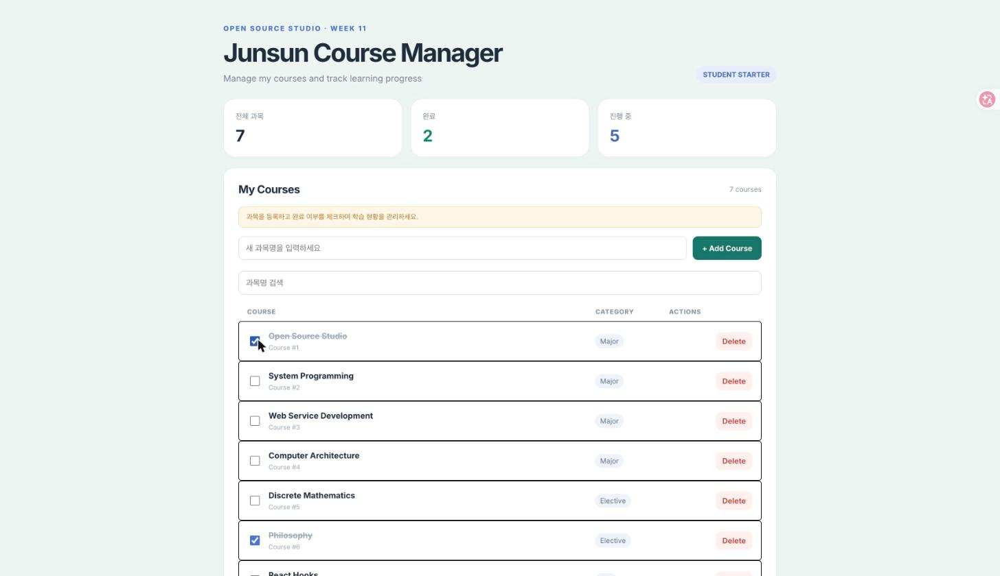
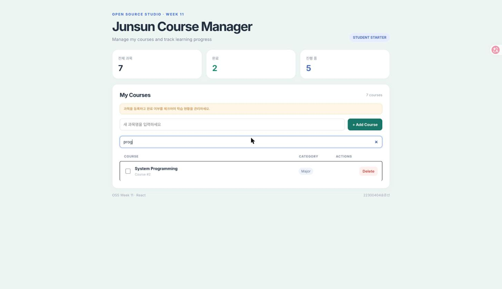

# Junsun Course Manager

## 프로젝트 소개

- React와 Vite로 만든 과목 관리 앱입니다.
- 과목 조회, 등록, 삭제, 완료 상태 변경, 검색과 통계를 제공합니다.
- 원본 Sample Project: https://github.com/2026-2-OSS/week11_sample_project
- GitHub Classroom: https://github.com/2026-2-OSS/assign11-c01-22300404
- 개인 GitHub 저장소: https://github.com/Evvvaaaaan/week11__oss

## 설치 및 실행

- week11_sample_project 폴더에서 실행합니다.
- npm install
- npm run dev
- 터미널에 표시된 주소로 접속합니다.
- 빌드 확인: npm run build

## 실행 화면

- 첫 화면
- 
- 과목 등록과 완료 체크
- 
- 등록된 과목
- 
- 과목명 검색
- 

## 소스 구조와 상태 관리

- src/App.jsx: 제목, 설명, 과목 목록과 하단 정보를 배치합니다.
- src/components/CourseList.jsx: 과목 배열, 등록 입력값, 검색어를 useState로 관리하고 이벤트를 처리합니다.
- src/components/CourseItem.jsx: 부모에게 받은 과목을 표시하고 체크박스와 삭제 버튼을 제공합니다.
- CourseList는 course, onDelete, onToggle을 Props로 전달합니다.
- 자식의 이벤트에서 콜백에 과목 id를 전달하면 부모가 setCourses로 상태를 변경합니다.
- 삭제는 확인창에서 승인한 뒤 filter로 해당 과목을 제외합니다.

## 주요 코드 분석

### 과목 등록

- 공백 입력을 막고 새 과목을 만든 뒤 기존 배열 끝에 추가합니다.
- if (!newName.trim()) return;
- const newCourse = {
-   id: Date.now(),
-   name: newName.trim(),
-   category: '기타',
-   completed: false
- };
- setCourses(previous => [...previous, newCourse]);
- setNewName('');
- ...previous는 기존 배열의 항목을 새 배열에 펼칩니다. 상태 갱신 후 목록이 다시 표시되고 입력창이 비워집니다.

### 완료 상태 변경

- 선택한 과목만 새 객체로 만들고 completed를 반전합니다.
- setCourses(previous => previous.map(course => {
-   if (course.id === id) {
-     return { ...course, completed: !course.completed };
-   }
-   return course;
- }));
- ...course는 기존 속성을 얕게 복사합니다. 뒤의 completed가 기존 값을 덮어쓰므로 다른 정보는 유지됩니다.

## Customizing

- src/data/courses.js: 초기 데이터를 직접 선택한 과목 6개로 변경했습니다.
- src/App.jsx와 index.html: 프로젝트 제목과 설명을 변경했습니다.
- src/App.css: 배경색, 통계 카드 모서리, 등록 버튼 색상과 마우스를 올렸을 때의 색상을 변경했습니다.

## Feature Extension

- 과목 등록: 빈 값과 공백 입력을 막고 등록 즉시 목록과 통계를 갱신합니다.
- 완료 상태 변경: 체크박스로 완료 여부를 전환하고 완료된 이름에 취소선을 표시합니다.
- 과목명 검색: 대소문자를 구분하지 않고 검색하며 결과가 없으면 안내를 표시합니다.
- 전체, 완료, 진행 중 과목 수를 표시합니다.
- 기존 조회와 삭제 기능을 유지합니다.
- 데이터는 React 상태에만 저장하므로 새로고침하면 초기화됩니다.
- 빌드와 DOM 환경의 등록, 완료 전환, 통계, 검색, 삭제 동작 검증을 통과했습니다.
- 실제 브라우저와 배포 환경의 최종 확인은 필요합니다.

## Deployment

- Vercel URL: https://week11-webservice.vercel.app/
- GitHub Push 후 자동 배포 확인: 진행 필요

## Weekly Review

- 새롭게 배운 내용 3가지: 직접 작성 필요
- 어려웠던 점과 해결 방법: 직접 작성 필요
- AI 활용: 코드 설명, 검색과 스타일 구현, 오류 조사, 검증 및 README 초안 작성 지원
- 직접 수행한 작업과 AI 활용에 대한 느낀 점: 직접 작성 필요
